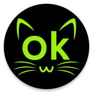

<div align="center">
<br />

</div>

<h1 align="center">OpenKick</h1>

<p align="center">
  An open-source Android client for <a href="https://kick.com">Kick.com</a> with account sign-in, live chat, streams, clips, and VODs.<br />
  Available in English, Spanish, Russian, and Simplified Chinese (简体中文).
</p>

<div align="center">
  <a href="https://github.com/Gallbladderz/OpenKick/releases"></a>
  &nbsp;&nbsp;
  <a href="https://apps.obtainium.imranr.dev/redirect?r=obtainium://app/%7B%22id%22%3A%22com.gallbladderz.openkick%22%2C%22url%22%3A%22https%3A%2F%2Fgithub.com%2FGallbladderz%2FOpenKick%22%2C%22author%22%3A%22Gallbladderz%22%2C%22name%22%3A%22OpenKick%22%2C%22additionalSettings%22%3A%22%7B%5C%22appName%5C%22%3A%5C%22OpenKick%5C%22%2C%5C%22appAuthor%5C%22%3A%5C%22Gallbladderz%5C%22%2C%5C%22about%5C%22%3A%5C%22An%20open-source%20Android%20client%20for%20Kick.com.%5C%22%7D%22%7D"></a>
</div>

## Features

- **Kick account and guest mode.** Sign in to sync followed channels and categories and write in chat. Guest mode keeps follows on your device and lets you read chat.
- **Live streams, VODs, and clips.** Rewind live streams when a DVR window or archive is available, jump back to live, and resume VODs where you stopped. The player includes quality selection and fullscreen gestures for brightness and volume.
- **Mini-player, background playback, and picture-in-picture.** Minimize streams, clips, and VODs inside the app or keep watching or listening while using other apps.
- **Downloads and offline playback.** Download clips and VODs in the background, choose a quality and time range for supported VODs, and play saved media offline. Manage downloads from Settings.
- **Live chat and chat replay.** Swipe to reply, view pinned messages and badges, and see unread counts when scrolling is paused. Watch synchronized chat replay on supported clips and VODs.
- **Kick and 7TV emotes.** Search the emote picker, browse channel and global 7TV sets, and view animated, wide, and overlapping emotes. Toggle 7TV in chat settings.
- **Following and notifications.** See which followed channels are live, search your follows, and receive alerts when followed channels go live.
- **Search, discovery, and Kick links.** Search channels, streams, and categories, browse category feeds and streamer profiles, and open Kick links to channels, categories, clips, and VODs in the app.
- **Personalization.** Use dynamic colors or Catppuccin themes and adjust chat text size, name colors, badges, and emote animation with a live preview.

## Build

Use JDK 17 for Gradle and install Android SDK Platform 36 in Android Studio's SDK Manager. To run the app, use a device or emulator with Android 8.0 (API 26) or later.

```bash
git clone https://github.com/Gallbladderz/OpenKick.git
cd OpenKick
```

Open the project in Android Studio, sync Gradle, and run the `app` configuration. To build a debug APK from the terminal, use the Gradle wrapper from the project root.

```bash
./gradlew :app:assembleDebug
```

On Windows (PowerShell), run `.\gradlew.bat :app:assembleDebug`. The APK is generated at `app/build/outputs/apk/debug/app-debug.apk`.

### Authentication configuration

Guest mode and Kick account sign-in work with the default build configuration. Choose **Sign in to Kick** on the welcome screen or in Settings, confirm the prompt, and sign in on the Kick website inside the app. OpenKick picks up your session and returns you to the app.

The channel-follow and OAuth API clients use `https://kick.com/` by default. For development against a compatible backend, set the optional `bffBaseUrl` in your user-level Gradle properties.

## Privacy

Guest follows and app settings are stored locally on the device. When you sign in, OpenKick stores the session required to access your Kick account and synchronizes account follows with Kick.

When 7TV emotes are enabled, OpenKick fetches global and channel emote sets from `7tv.io`.

## License

OpenKick is distributed under the **GPL-3.0 License**. See [LICENSE](LICENSE) for the full license text.

OpenKick is not affiliated with Kick.com.
