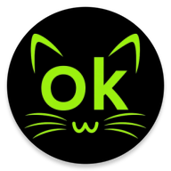

<div align="center">
<br />

</div>

<h1 align="center">OpenKick</h1>

<p align="center">
  An open-source Android client for <a href="https://kick.com">Kick.com</a> with account sign-in, live chat, streams, clips, and VODs.<br />
  Available in English, Spanish, and Russian.
</p>

<div align="center">
  <a href="https://github.com/Gallbladderz/OpenKick/releases"></a>
  &nbsp;&nbsp;
  <a href="https://apps.obtainium.imranr.dev/redirect?r=obtainium://app/%7B%22id%22%3A%22com.gallbladderz.openkick%22%2C%22url%22%3A%22https%3A%2F%2Fgithub.com%2FGallbladderz%2FOpenKick%22%2C%22author%22%3A%22Gallbladderz%22%2C%22name%22%3A%22OpenKick%22%2C%22additionalSettings%22%3A%22%7B%5C%22appName%5C%22%3A%5C%22OpenKick%5C%22%2C%5C%22appAuthor%5C%22%3A%5C%22Gallbladderz%5C%22%2C%5C%22about%5C%22%3A%5C%22An%20open-source%20Android%20client%20for%20Kick.com.%5C%22%7D%22%7D"></a>
</div>

## Features

- **Kick account sign-in:** Authenticate through Kick and use your account from the app.
- **Guest mode:** Browse Kick and keep local follows without signing in.
- **Live streams, VODs, and clips:** Watch content with Media3/ExoPlayer playback.
- **Live chat:** Read and send messages, use replies and emotes, and view badges and name colors.
- **Following sync:** Keep followed channels and categories in sync with Kick after signing in, or manage them locally in guest mode.
- **Background playback and PiP:** Continue listening or watching while using other apps.
- **Notifications:** Receive notifications when followed channels go live.
- **Search and discovery:** Find channels, streams, clips, categories, and category details.
- **Personalization:** Use dynamic colors, Catppuccin themes, language settings, and chat display controls.

## Build

OpenKick is an Android Studio project built with Kotlin, Jetpack Compose, and Gradle. Use JDK 17 or newer.

```bash
git clone https://github.com/Gallbladderz/OpenKick.git
cd OpenKick
```

Open the project in Android Studio, allow Gradle to sync, and run the `app` configuration.

### Authentication configuration

The app can be built and used in guest mode without additional configuration. To enable OAuth sign-in in a custom build, provide the Kick client identifier as a Gradle property:

```properties
kickClientId=your_kick_client_id
```

Keep local or environment-specific values outside the repository. The default BFF endpoint is `https://kick.com/`; it can be overridden with the `bffBaseUrl` Gradle property when needed.

## Privacy

Guest follows and app settings are stored locally on the device. When you sign in, OpenKick stores the session required to access your Kick account and synchronizes account follows with Kick.

## License

OpenKick is distributed under the **GPL-3.0 License**. See [LICENSE](LICENSE) for the full license text.
